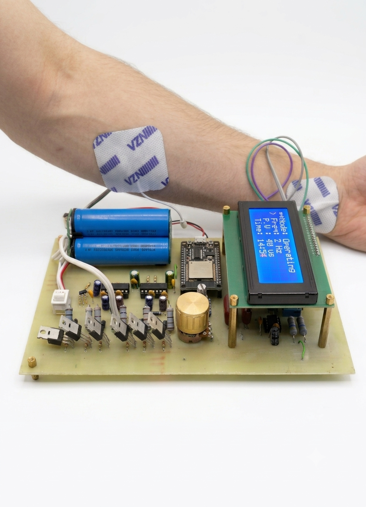
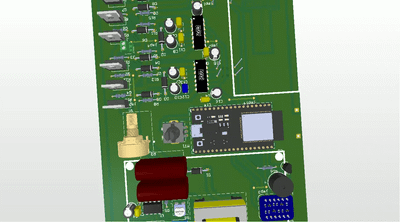
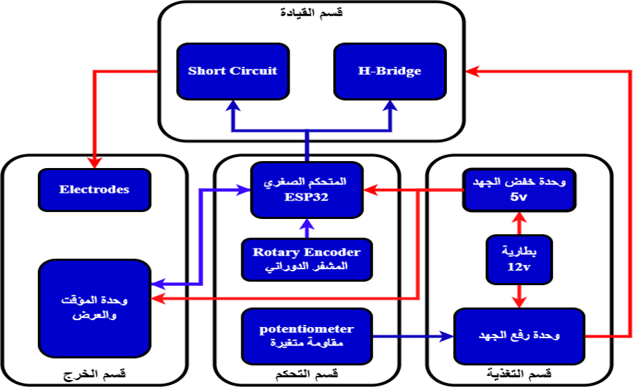
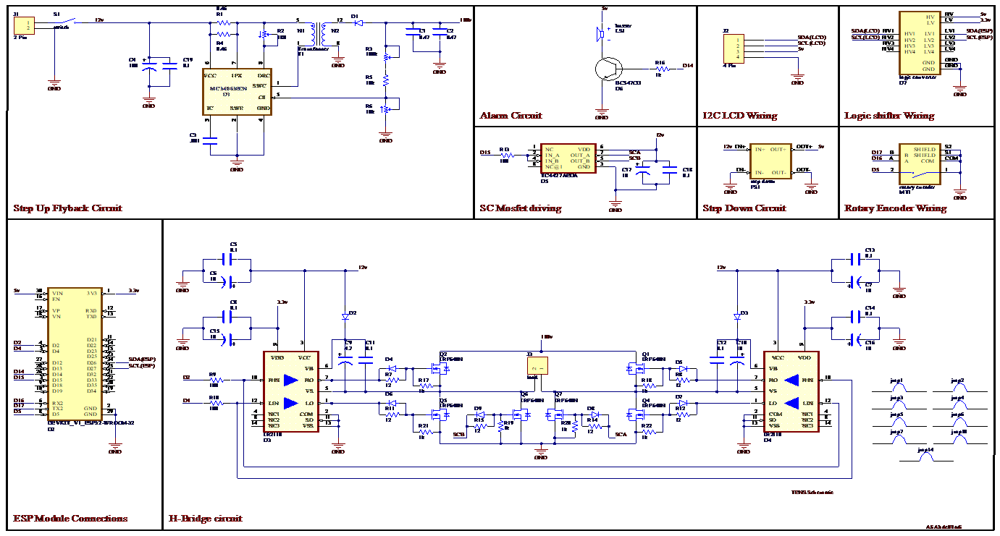
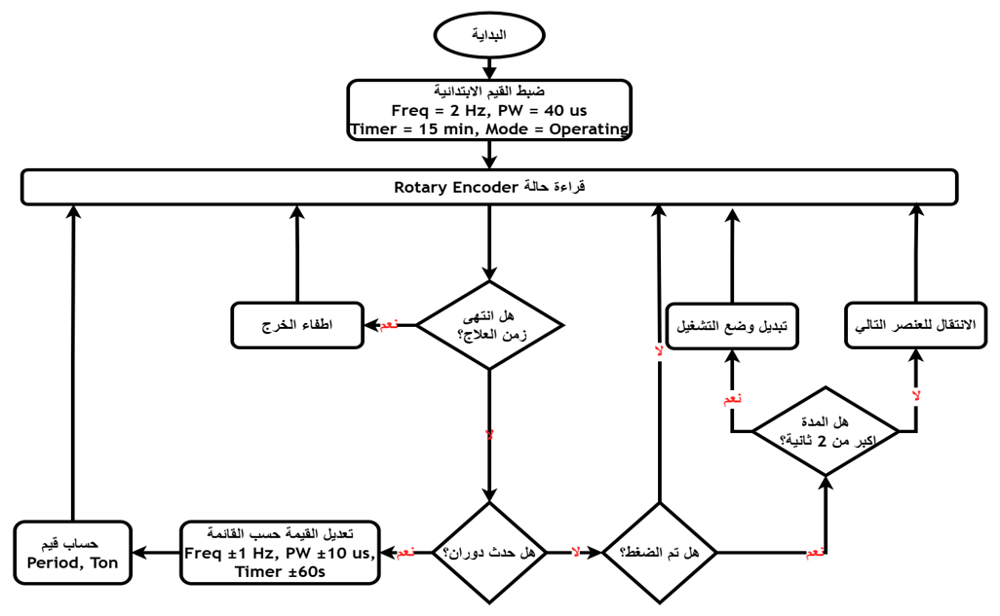

# Transcutaneous Electrical Nerve Stimulation (TENS) Device

A portable, microcontroller-based **Transcutaneous Electrical Nerve Stimulation (TENS)** prototype designed and implemented for non-pharmacological pain relief, developed as a graduation project in Biomedical Electronics Engineering at the University of Aleppo.

> **Author:** Ali Abdulhadi (ID: 203028)  
> **Supervisor:** Prof. Dr. Louay Shashati  
> **Institution:** Faculty of Electrical and Electronic Engineering — Department of Electronic Engineering (Biomedical Electronics), University of Aleppo  
> **Repository Sections:** [Main `docs` Folder](https://github.com/ali200105/ESP32-TENS-Pain-Relief-Device/tree/main/docs) · [Images Folder (`images/`)](https://github.com/ali200105/ESP32-TENS-Pain-Relief-Device/tree/main/images) · [Hardware Folder (`hardware/`)](https://github.com/ali200105/ESP32-TENS-Pain-Relief-Device/tree/main/hardware)

---

## Prototype Showcase & Research Poster

### Primary Prototype View

### Research Poster & 3D View

| Scientific Poster | 3D Model View |
| :---: | :---: |
|  |  |

* **3D View File (`3d.gif`):** [View in `images/`](https://github.com/ali200105/ESP32-TENS-Pain-Relief-Device/tree/main/images) *(3D preview reference)*
* **Research Poster (`A0-poster.jpg`):** [View in `images/`](https://github.com/ali200105/ESP32-TENS-Pain-Relief-Device/tree/main/images)

---

## System Block Diagram

* **Block Diagram (`boxdiagram.png`):** [View in `images/`](https://github.com/ali200105/ESP32-TENS-Pain-Relief-Device/tree/main/images)

---

## Hardware & Circuit Diagrams

### Circuit Schematics

| Schematic 1 | Schematic 2 | Schematic 3 |
| :---: | :---: | :---: |
|  |  |  |

* **Circuit Diagram 1 (`circuit-diagram-1.jpg`):** [View in `hardware/`](https://github.com/ali200105/ESP32-TENS-Pain-Relief-Device/tree/main/hardware)
* **Circuit Diagram 2 (`circuit-diagram-2.jpg`):** [View in `hardware/`](https://github.com/ali200105/ESP32-TENS-Pain-Relief-Device/tree/main/hardware)
* **Circuit Diagram 3 (`circuit-diagram-3.png`):** [View in `hardware/`](https://github.com/ali200105/ESP32-TENS-Pain-Relief-Device/tree/main/hardware)

### PCB Layout (PNG)

* **PCB Layout (`pcb.png` & Hardware Files):** [View in `hardware/`](https://github.com/ali200105/ESP32-TENS-Pain-Relief-Device/tree/main/hardware)

---

## Oscilloscope Measurements & Flowchart

### Control & Stimulation Waveforms

| Driver Pulses | Stimulation Pulses |
| :---: | :---: |
|  |  |

* **Driver Pulses (`driver-pulses.jpg`):** [View in `images/`](https://github.com/ali200105/ESP32-TENS-Pain-Relief-Device/tree/main/images)
* **Stimulation Pulses (`stimulation-pulses.jpg`):** [View in `images/`](https://github.com/ali200105/ESP32-TENS-Pain-Relief-Device/tree/main/images)

### System Flowchart

* **Flowchart (`flowchart.png`):** [View in `images/`](https://github.com/ali200105/ESP32-TENS-Pain-Relief-Device/tree/main/images)

---

## Additional Project Files & Folders

* **`docs/` Folder:** [Open `docs` on GitHub](https://github.com/ali200105/ESP32-TENS-Pain-Relief-Device/tree/main/docs) (thesis & project documents)
* **`images/` Folder:** [Open `images` on GitHub](https://github.com/ali200105/ESP32-TENS-Pain-Relief-Device/tree/main/images) (prototype, poster, 3D, waveforms, block diagram, and flowchart images)
* **`hardware/` Folder:** [Open `hardware` on GitHub](https://github.com/ali200105/ESP32-TENS-Pain-Relief-Device/tree/main/hardware) (circuit diagrams, PCB PNG, and hardware files)

---

## Safety Notice

This prototype was developed for academic and research purposes. TENS devices should **not** be used on individuals with cardiac pacemakers, across the neck or carotid sinus area, in paths crossing the heart, or on the head/for headaches without proper medical supervision.